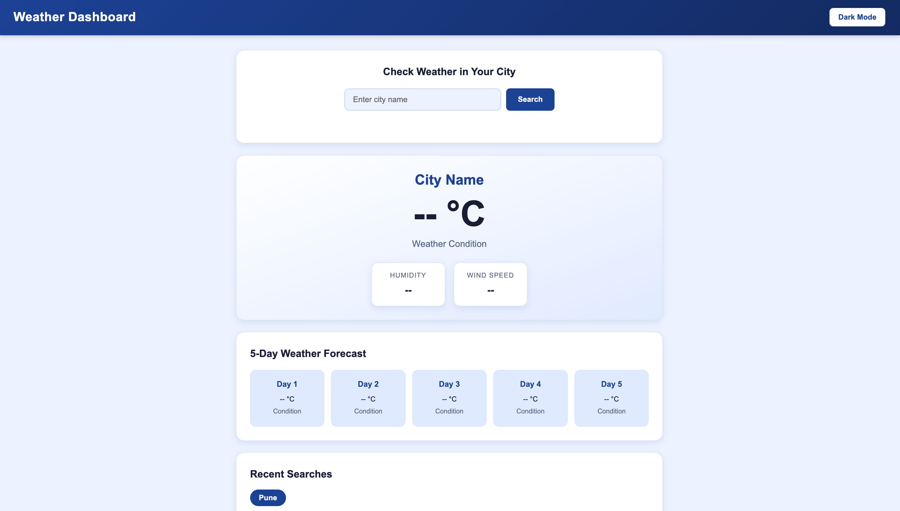
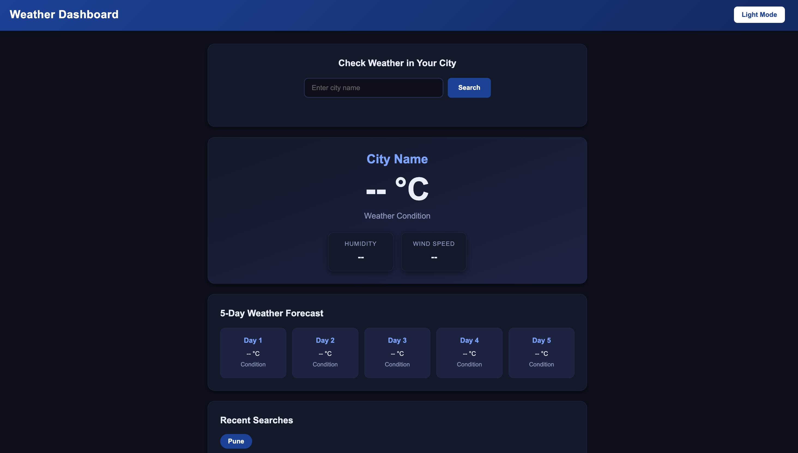

# 🌦️ Weather Dashboard

**A responsive and interactive weather application built using HTML, CSS, and JavaScript.**

🚀 **Live Demo:** [View Weather Dashboard](https://weatherdashboard-ten-gules.vercel.app/)

[](https://weatherdashboard-ten-gules.vercel.app/)


---

## 📌 About the Project

Weather Dashboard is a web application that allows users to search for a city and view its current weather conditions along with a five-day forecast.

The application retrieves weather data using the Open-Meteo API and presents it through a clean, user-friendly interface. It also includes light and dark themes and a recent-searches feature for a convenient user experience.

## ✨ Key Features

- 🌍 **City Search:** Search for weather information by city name.
- 🌡️ **Current Temperature:** Display the current temperature in Celsius.
- 🌤️ **Weather Conditions:** View a description of current weather conditions.
- 💧 **Humidity:** Display relative humidity.
- 💨 **Wind Speed:** Display wind speed in km/h.
- 📅 **Five-Day Forecast:** View daily weather conditions and maximum/minimum temperatures.
- 🌙 **Dark and Light Mode:** Switch between two visual themes.
- 🕘 **Recent Searches:** Revisit up to five recently searched cities.
- 💾 **Local Storage:** Save theme preferences and recent searches in the browser.
- ⚠️ **Error Handling:** Handle invalid city searches and API request errors.

## 🖥️ Screenshots

### ☀️ Light Mode



### 🌙 Dark Mode



## 🛠️ Technologies Used

| Technology | Purpose |
|---|---|
| HTML5 | Structure and layout |
| CSS3 | Styling, responsive layout, and themes |
| JavaScript | Application logic and interactivity |
| Fetch API | Fetching data from external APIs |
| Async/Await | Handling asynchronous operations |
| Open-Meteo API | City geocoding and weather data |
| Local Storage | Saving theme and recent searches |
| Git & GitHub | Version control and source code hosting |
| Vercel | Deployment and hosting |

## 🌐 API Integration

This project uses the free Open-Meteo services.

**1. Geocoding API**

Converts city names into geographical coordinates.

Documentation: [Open-Meteo Geocoding API](https://open-meteo.com/en/docs/geocoding-api)

**2. Weather Forecast API**

Retrieves current temperature, relative humidity, wind speed, weather codes, and a five-day forecast.

Documentation: [Open-Meteo Weather API](https://open-meteo.com/en/docs)

**API Key:** No API key is required for the endpoints used in this project.

## 📂 Project Structure

```text
Weather_Dashboard/
├── index.html
├── style.css
├── script.js
├── README.md
└── screenshots/
    ├── light-mode.png
    └── dark-mode.png
```

## 🚀 Getting Started

### Prerequisites

- A modern web browser
- Visual Studio Code
- An internet connection

### Installation

**1. Clone the repository**

```bash
git clone https://github.com/sarthakarora0907-boop/Weather_Dashboard.git
```

**2. Navigate to the project folder**

```bash
cd Weather_Dashboard
```

**3. Open the project in VS Code**

```bash
code .
```

Alternatively, open the folder manually in Visual Studio Code.

**4. Run the application**

Open `index.html` using the Live Server extension or open it directly in your browser.

**5. Search for a city**

Enter a city name and click **Search** to explore its current weather information and forecast.

An active internet connection is required to retrieve weather data.

## 🧠 Concepts Demonstrated

- HTML forms and page structure
- CSS variables and theme management
- JavaScript event listeners
- Fetch API and JSON processing
- Async/await and error handling
- DOM manipulation
- Browser Local Storage
- Git version control
- Deployment using Vercel

## 🔮 Future Enhancements

- Add weather icons and visual indicators.
- Introduce Celsius/Fahrenheit conversion.
- Add current-location weather using geolocation.
- Improve forecast visualization.
- Add city autocomplete suggestions.

## 👨‍💻 Author

**Sarthak Arora**

- GitHub: [@sarthakarora0907-boop](https://github.com/sarthakarora0907-boop)
- Live Project: [Weather Dashboard](https://weatherdashboard-ten-gules.vercel.app/)

---

<p align="center">
  Built with ❤️ using HTML, CSS, and JavaScript.
</p>
